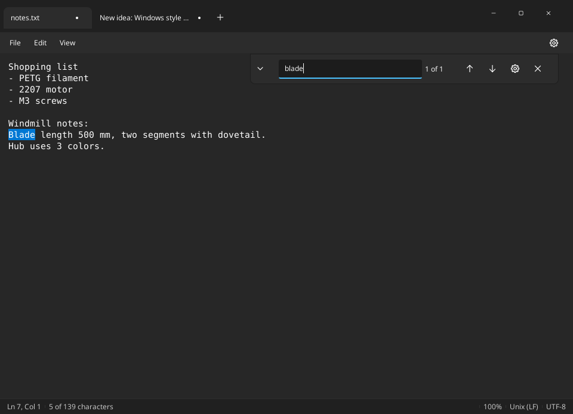
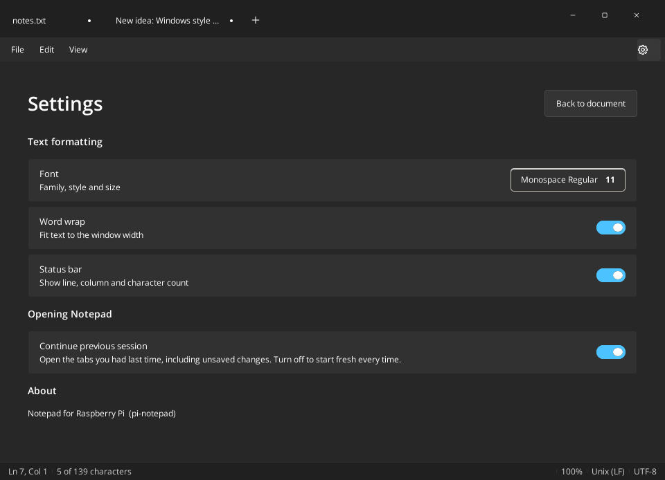

# pi-notepad

A Windows 11 Notepad style Notepad app for the Raspberry Pi (built for the Pi 5, works on other Pis running Raspberry Pi OS). Native GTK app with the Windows 11 dark look, made to match [pi-explorer](https://github.com/wvfouram/pi-explorer) and [pi-taskmgr](https://github.com/wvfouram/pi-taskmgr).



## Features

- **Tabs** in the title bar (Ctrl+N, Ctrl+W, Ctrl+Tab). A dot on a tab means it has unsaved changes
- **Picks up where you left off**: tabs, cursor position and even unsaved text come back the next time you open it (can be turned off in Settings)
- **Find and replace** panel (Ctrl+F, Ctrl+H) with match case and wrap around, F3 / Shift+F3 to jump between results
- **Go to line** (Ctrl+G), **Time/Date** (F5), undo/redo, word wrap, zoom (Ctrl+wheel, Ctrl+plus/minus/0)
- **Status bar** with line, column, character count, zoom, line endings (Unix LF or Windows CRLF) and encoding
- Keeps each file's line endings and encoding (UTF-8, UTF-8 with BOM, ANSI) when saving
- **Settings** page: font, word wrap, status bar and session restore
- Drag files onto the window to open them; opening a file from File Explorer adds a tab to the open window



## Install

In a terminal on the Pi (as your normal user, not with sudo):

```
git clone https://github.com/wvfouram/pi-notepad.git && bash pi-notepad/install.sh
```

Then open **Notepad** from the menu, or run `pi-notepad`.

Becomes the default app for plain text (.txt) files. Uninstalling puts the previous app back.

To update later:

```
cd ~/pi-notepad && git pull && bash install.sh
```

## Keyboard shortcuts

| Keys | Action |
|---|---|
| Ctrl+N / Ctrl+Shift+N | New tab / new window |
| Ctrl+O | Open |
| Ctrl+S / Ctrl+Shift+S | Save / Save as |
| Ctrl+Alt+S | Save all |
| Ctrl+W | Close tab |
| Ctrl+F / Ctrl+H | Find / Replace |
| F3 | Find next |
| Ctrl+G | Go to line |
| F5 | Insert time and date |
| Ctrl+Z / Ctrl+Y | Undo / Redo |
| Ctrl+Plus / Minus / 0 | Zoom |

## Uninstall

```
bash pi-notepad/uninstall.sh
```

## License

MIT
